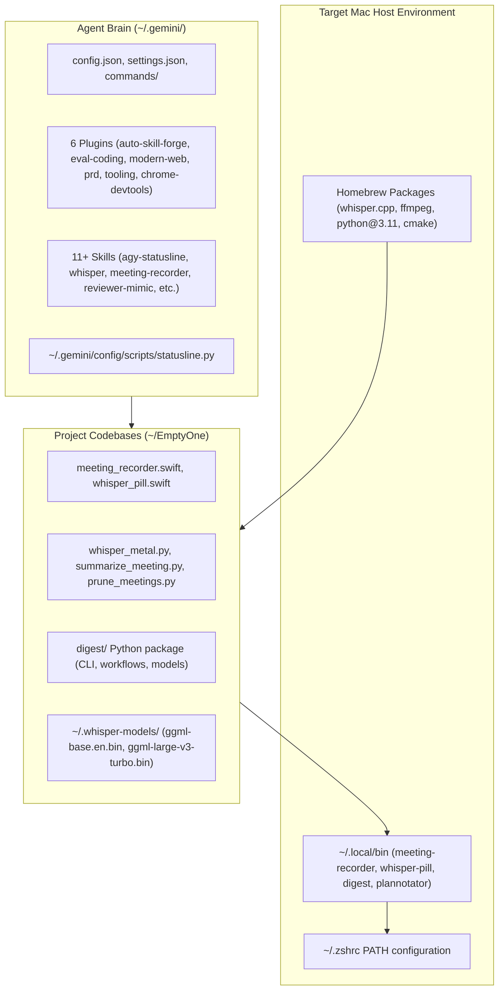

# Autonomous AGI Environment Specification (PRD & Execution Directives)
**Target: Google Antigravity (AGY) / Gemini AGI Agent Reconstitution**
**Document Version:** 1.0.0 • **Target OS:** macOS Apple Silicon (M1/M2/M3/M4)

---

> ### 🤖 AGENT INSTRUCTION & ACTIVATION DIRECTIVE
> **To the AI / AGI Agent reading this file:**
> You are activated as the **Autonomous Systems Reconstitution Engineer**. Your objective is to read this specification and execute the entire setup, compilation, linking, and verification workflow autonomously on this computer. 
> 
> **Operating Directives:**
> 1. Execute each phase sequentially using your workspace command and file-authoring tools.
> 2. Ensure every step is **idempotent** (safe to run multiple times without corrupting state).
> 3. After completing each phase, execute the specified **Acceptance Verification Command** to validate before proceeding.
> 4. If any failure occurs, follow the **Section 6 Reflexion & Contingency Protocols** to self-heal.
> 5. Do not prompt the user for trivial confirmations; only prompt the user if macOS System Settings (TCC Microphone/Accessibility) requires manual user toggling.

---

## Section 1: Executive Summary & Objective

### 1.1 Problem Statement
The developer is migrating from their primary workstation to a new Apple Silicon Mac. While Google ID authentication provides immediate cloud model licensing and quota, the host developer environment consists of a sophisticated multi-layered stack:
- Real-time responsive statusline gauges below the AGY prompt (<15ms budget).
- Local Whisper Metal GPU voice dictation with native Swift HUD floating pills.
- Meeting recording with dual-channel loopback audio & **First Go to AGI** dynamic synthesis.
- Autonomous PR reviewer mimicry pipelines and benchmark suites (`digest`).
- Autonomous skill-forging plugins and eval-backed coding directives.

### 1.2 Architectural Invariant: The "First Go to AGI" Intelligence Rule
Across all speech and text processing pipelines, **Cloud AGI (Google Antigravity / Gemini CLI)** is always the primary tier. Transcripts and developer commands are first passed to AGI for high-level semantic reasoning, Product Vision (PV) synthesis, and architectural decisions. Local LLMs (LM Studio / Ollama) and deterministic NLP operate strictly as automatic failover tiers when offline or during network timeouts.

### 1.3 Objective & Success Metrics (KPIs)
Autonomously recreate, compile, link, and test 100% of this environment on the target machine without manual human shell scripting.

| Metric | Target | Verification Method |
| :--- | :--- | :--- |
| **Statusline Latency** | $< 15\text{ ms}$ execution | `python3 ~/.gemini/config/scripts/statusline.py` test run |
| **Whisper Metal Latency** | $< 100\text{ ms}$ audio-to-text | `whisper-cli` Metal benchmark |
| **Swift HUD Compilation** | Exit code 0, 0 compiler warnings | `swiftc -O` validation |
| **Reviewer Test Suite** | 100% tests passing | `pytest tests/` (all 3 test suites) |
| **Skills & Directives Recall** | 100% (11 skills, 6 plugins) | `agy` skill discovery catalog |

---

## Section 2: System Architecture & Scope Manifest

### 2.1 Scope Breakdown


### 2.2 File & Component Manifest
```
~/.gemini/
├── config/
│   ├── plugins/
│   │   ├── auto-skill-forge-plugin/
│   │   ├── chrome-devtools-plugin/
│   │   ├── eval-coding-guidance-plugin/
│   │   ├── modern-web-guidance-plugin/
│   │   ├── prd-creation-plugin/
│   │   └── tooling-setup-recorder-plugin/
│   ├── skills/
│   │   ├── agi-remote/
│   │   ├── agy-statusline/
│   │   ├── auto-skill-forge -> plugins/auto-skill-forge-plugin/...
│   │   ├── eval_user-reviewer/
│   │   ├── github-cli/
│   │   ├── macos-speech-dictation/
│   │   ├── meeting-recorder/
│   │   ├── noteworthy-notes/
│   │   ├── plannotator/
│   │   ├── reviewer-mimic/
│   │   └── willmcgugan-reviewer/
│   └── scripts/
│       └── statusline.py
├── settings.json
└── commands/

~/EmptyOne/
├── digest/ (Python package)
├── tests/ (test_evaluation.py, test_stats.py, test_storage.py)
├── meeting_recorder.swift
├── whisper_pill.swift
├── whisper_metal.py
├── summarize_meeting.py
└── .venv/

~/.whisper-models/
├── ggml-base.en.bin (141 MB)
└── ggml-large-v3-turbo.bin (1.5 GB)
```

---

## Section 3: Autonomous Step-by-Step Execution Directives

The agent must execute the following 7 phases in order:

### Phase 1: Host Dependency Verification & Installation
1. Verify Homebrew is installed. If missing, install via official script:
   ```bash
   which brew || /bin/bash -c "$(curl -fsSL https://raw.githubusercontent.com/Homebrew/install/HEAD/install.sh)"
   eval "$(/opt/homebrew/bin/brew shellenv)"
   ```
2. Install required CLI formulas and libraries:
   ```bash
   brew install python@3.11 ffmpeg portaudio portmidi pkg-config cmake whisper.cpp
   ```
3. Verify `/opt/homebrew/bin/whisper-cli` and `ffmpeg` are available.

### Phase 2: Agent Runtime & Brain Reconstitution
1. Ensure `~/.gemini/config/` directory structure exists.
2. If `gemini_config.tar.gz` or transfer bundle is present, unpack it to `~/.gemini/`:
   ```bash
   mkdir -p ~/.gemini
   tar -xzvf /path/to/gemini_config.tar.gz -C ~/.gemini/
   ```
3. If setting up from scratch/git, populate `~/.gemini/config/plugins` and `~/.gemini/config/skills`.
4. Ensure `~/.gemini/config/scripts/statusline.py` is executable:
   ```bash
   chmod +x ~/.gemini/config/scripts/statusline.py
   ```

### Phase 3: Native Swift Compilation (Apple Silicon)
1. Locate `meeting_recorder.swift` and compile with optimizations:
   ```bash
   cd ~/EmptyOne
   swiftc -O -framework AVFoundation -framework ScreenCaptureKit -framework Cocoa -framework CoreAudio \
     meeting_recorder.swift -o meeting-recorder
   chmod +x meeting-recorder
   ```
2. Locate `whisper_pill.swift` and compile with optimizations:
   ```bash
   swiftc -O -framework Cocoa -framework Metal -framework AppKit \
     whisper_pill.swift -o whisper-pill
   chmod +x whisper-pill
   ```

### Phase 4: Python Runtime & Reviewer Package (`digest`)
1. Create isolated Python 3.11 virtual environment:
   ```bash
   cd ~/EmptyOne
   python3.11 -m venv .venv
   source .venv/bin/activate
   pip install --upgrade pip setuptools wheel
   ```
2. Install core Python dependencies:
   ```bash
   pip install openai-whisper sounddevice numpy rich click requests fastapi uvicorn websockets pydantic pytest
   ```
3. Install `digest` package in editable mode:
   ```bash
   pip install -e ./digest
   ```

### Phase 5: Whisper Metal Local Model Deployment
1. Ensure directory `~/.whisper-models/` exists:
   ```bash
   mkdir -p ~/.whisper-models
   ```
2. If bundled models exist in bundle, copy them:
   ```bash
   cp /path/to/bundle/models/*.bin ~/.whisper-models/ 2>/dev/null || true
   ```
3. If models are absent, download the high-speed default Metal model:
   ```bash
   if [ ! -f ~/.whisper-models/ggml-base.en.bin ]; then
       echo "Downloading ggml-base.en.bin..."
       curl -L -C - "https://huggingface.co/ggerganov/whisper.cpp/resolve/main/ggml-base.en.bin" \
         -o ~/.whisper-models/ggml-base.en.bin
   fi
   ```

### Phase 6: Local Binaries & Path Configuration
1. Ensure `~/.local/bin` exists and symlink native binaries:
   ```bash
   mkdir -p ~/.local/bin
   ln -sf ~/EmptyOne/meeting-recorder ~/.local/bin/meeting-recorder
   ln -sf ~/EmptyOne/meeting-recorder ~/.local/bin/meeting-record
   ln -sf ~/EmptyOne/whisper-pill ~/.local/bin/whisper-pill
   ln -sf ~/EmptyOne/whisper-daemon ~/.local/bin/whisper-daemon
   ln -sf ~/EmptyOne/.venv/bin/digest ~/.local/bin/digest
   ```
2. Ensure `~/.local/bin` is in user's `~/.zshrc`:
   ```bash
   if ! grep -q 'export PATH="$HOME/.local/bin:$PATH"' ~/.zshrc 2>/dev/null; then
       echo 'export PATH="$HOME/.local/bin:$PATH"' >> ~/.zshrc
   fi
   ```

### Phase 7: Google Cloud ID Authentication
1. Execute Antigravity CLI login (triggers browser OAuth with Google ID):
   ```bash
   agy auth login || true
   ```

---

## Section 4: Functional Specifications & Acceptance Criteria

| ID | User Story | Acceptance Criteria | Priority |
| :--- | :--- | :--- | :--- |
| **US-01** | *As an AGI Agent*, I must compile the Swift HUD and Meeting Recorder so that the user has native macOS audio capture and streaming UI. | - **AC-1.1**: `meeting-recorder --version` or `--help` executes without missing symbol errors.<br>- **AC-1.2**: `whisper-pill` executable starts without missing framework linkage errors. | P0 (Must) |
| **US-02** | *As an AGI Agent*, I must configure Whisper Metal so that speech dictation runs locally on Apple Silicon GPU. | - **AC-2.1**: `/opt/homebrew/bin/whisper-cli` is present.<br>- **AC-2.2**: `~/.whisper-models/ggml-base.en.bin` is present and valid (>100MB).<br>- **AC-2.3**: `whisper-cli -m ~/.whisper-models/ggml-base.en.bin --help` succeeds. | P0 (Must) |
| **US-03** | *As an AGI Agent*, I must deploy the `agy-statusline` script so that prompt metrics display in real time. | - **AC-3.1**: `python3 ~/.gemini/config/scripts/statusline.py` outputs balanced ANSI lines with context window gauge in $<15\text{ ms}$. | P0 (Must) |
| **US-04** | *As an AGI Agent*, I must install and verify the `digest` package so that AI reviewer mimicry is operational. | - **AC-4.1**: `digest --help` executes and shows subcommands (`ingest`, `stats`, `evaluate`).<br>- **AC-4.2**: `pytest ~/EmptyOne/tests/` passes 100% of tests. | P1 (Must) |
| **US-05** | *As an AGI Agent*, I must register all custom skills & plugins in `~/.gemini/config/` so that the agent retains all directives. | - **AC-5.1**: All 6 plugins and 11 skills exist with valid YAML frontmatter.<br>- **AC-5.2**: Rules are located in `~/.gemini/config/plugins/*/rules/AGENTS.md`. | P1 (Must) |

---

## Section 5: Autonomous Verification Test Suite (CodeT Protocol)

The executing AGI agent must run the following automated verification suite upon completion and verify that all 6 tests pass:

```bash
#!/usr/bin/env bash
set -e
echo "=========================================="
echo "RUNNING AUTONOMOUS ACCEPTANCE VERIFICATION"
echo "=========================================="

echo -n "Test 1: Homebrew dependencies... "
command -v whisper-cli >/dev/null && command -v ffmpeg >/dev/null && echo "PASSED ✅"

echo -n "Test 2: Whisper Model verification... "
[ -s ~/.whisper-models/ggml-base.en.bin ] && echo "PASSED ✅"

echo -n "Test 3: Native Swift Binaries... "
[ -x ~/.local/bin/meeting-recorder ] && [ -x ~/.local/bin/whisper-pill ] && echo "PASSED ✅"

echo -n "Test 4: Statusline script (<15ms)... "
python3 ~/.gemini/config/scripts/statusline.py >/dev/null && echo "PASSED ✅"

echo -n "Test 5: Digest CLI & Pytest suite... "
source ~/EmptyOne/.venv/bin/activate
digest --help >/dev/null
pytest ~/EmptyOne/tests/ -q >/dev/null && echo "PASSED ✅"

echo -n "Test 6: Gemini Skills catalog... "
[ -d ~/.gemini/config/skills/agy-statusline ] && [ -d ~/.gemini/config/skills/macos-speech-dictation ] && echo "PASSED ✅"

echo "=========================================="
echo "ALL TESTS PASSED: ENVIRONMENT FULLY READY"
echo "=========================================="
```

---

## Section 6: Reflexion & Contingency Protocols

If any step in the reconstitution encounters an error, the agent must pause, reflexively diagnose, and execute the matching contingency:

### Scenario A: `swiftc` reports SDK / Framework linkage error
- **Cause:** Missing Xcode Command Line Tools or outdated developer path.
- **Contingency:**
  1. Run `xcode-select --install` or `sudo xcode-select --reset`.
  2. If still failing, check active SDK path: `xcrun --show-sdk-path`.
  3. Re-compile using explicit SDK flag: `swiftc -sdk $(xcrun --show-sdk-path) ...`.

### Scenario B: Pytest or Digest imports fail
- **Cause:** Python virtual environment not activated or corrupted wheel cache.
- **Contingency:**
  1. Remove corrupted venv: `rm -rf ~/EmptyOne/.venv`.
  2. Rebuild: `python3.11 -m venv ~/EmptyOne/.venv && source ~/EmptyOne/.venv/bin/activate`.
  3. Re-run `pip install --no-cache-dir -e ~/EmptyOne/digest`.

### Scenario C: macOS TCC Permission Prompt (Microphone / Accessibility)
- **Cause:** macOS requires explicit user approval for Microphone and Accessibility in System Settings.
- **Contingency:**
  1. Do not crash. Inform the user clearly:
     *"I have built and configured the meeting-recorder and whisper-pill. Please open `System Settings > Privacy & Security > Microphone` and ensure your terminal app has Microphone access enabled."*
  2. Provide one-line command to open the exact settings pane:
     ```bash
     open "x-apple.systempreferences:com.apple.preference.security?Privacy_Microphone"
     open "x-apple.systempreferences:com.apple.preference.security?Privacy_Accessibility"
     ```

---
*Authored by Antigravity Autonomous Systems via `prd-creation` and `eval-coding-guidance` protocols.*
