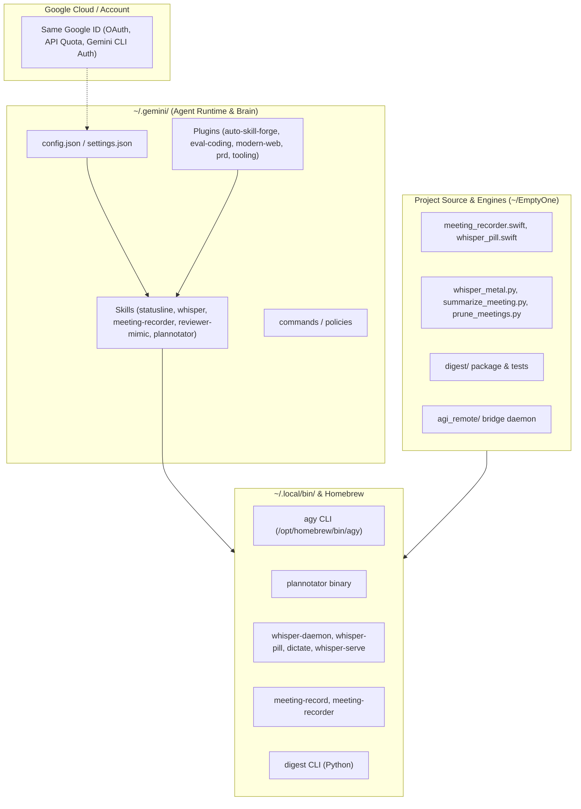

# Gemini AGI & Antigravity Setup Migration Guide
**Comprehensive Multi-Machine Migration Plan for Apple Silicon macOS**

This guide provides an end-to-end blueprint to migrate your entire Google Antigravity / Gemini AGI environment, local AI engines, Swift HUDs, reviewer apps, status bar, and autonomous skill pipelines to another Mac.

---

## Table of Contents
1. [Inventory: What Makes Up Your Setup](#1-inventory-what-makes-up-your-setup)
2. [What Google ID Syncs vs. What Stays Local](#2-what-google-id-syncs-vs-what-stays-local)
3. [4 Migration Approaches Compared](#3-4-migration-approaches-compared)
4. [Method 1: One-Click Bundle & Restore (Recommended)](#4-method-1-one-click-bundle--restore-recommended)
5. [Method 2: Private Git / Dotfiles Repository (Continuous Sync)](#5-method-2-private-git--dotfiles-repository-continuous-sync)
6. [Method 3: Direct Peer-to-Peer Transfer (AirDrop / rsync)](#6-method-3-direct-peer-to-peer-transfer-airdrop--rsync)
7. [Component-by-Component Restoration & Verification](#7-component-by-component-restoration--verification)
   - [A. Whisper Voice Dictation & Swift HUD](#a-whisper-voice-dictation--swift-hud)
   - [B. Meeting Recorder & Local Summarizer](#b-meeting-recorder--local-summarizer)
   - [C. Real-time Statusline (`agy-statusline`)](#c-real-time-statusline-agy-statusline)
   - [D. Code Reviewer Mimic & Digest Suite](#d-code-reviewer-mimic--digest-suite)
   - [E. All Gemini Skills, Plugins & Directives](#e-all-gemini-skills-plugins--directives)
   - [F. Plannotator & AGI Remote Bridge](#f-plannotator--agi-remote-bridge)
8. [Target Machine Prerequisites & Permissions](#8-target-machine-prerequisites--permissions)
9. [Pre-Flight Checklist on the New Machine](#9-pre-flight-checklist-on-the-new-machine)

---

## 1. Inventory: What Makes Up Your Setup

Your current developer machine contains a multi-tiered architecture spanning cloud authentication, agent configurations, native Swift binaries, and Python packages:



### Detailed Breakdown:
| Layer | Components | Source Location |
| :--- | :--- | :--- |
| **Agent Core** | Antigravity CLI, Gemini configs, settings | `/opt/homebrew/bin/agy`, `~/.gemini/` |
| **Agent Plugins (6)** | `auto-skill-forge`, `eval-coding-guidance`, `tooling-setup-recorder`, `modern-web-guidance`, `prd-creation`, `chrome-devtools` | `~/.gemini/config/plugins/` |
| **Agent Skills (11+)** | `agy-statusline`, `macos-speech-dictation`, `meeting-recorder`, `reviewer-mimic`, `eval_user-reviewer`, `willmcgugan-reviewer`, `noteworthy-notes`, `agi-remote`, `plannotator*`, `github-cli` | `~/.gemini/config/skills/` |
| **Voice & Whisper** | Whisper Metal GPU engine, `whisper_pill.swift` HUD, `dictate`, `whisper-daemon` | `~/EmptyOne/`, `~/.local/bin/` |
| **Meeting Recorder** | `meeting_recorder.swift` (native Audio/ScreenCaptureKit), `summarize_meeting.py` | `~/EmptyOne/`, `~/.local/bin/` |
| **Reviewer Engine** | `digest` python package, reviewer mimic models, benchmark backtesting | `~/EmptyOne/digest/`, `~/.local/bin/digest` |
| **Statusline** | Sub-15ms real-time statusline & context gauge | `~/.gemini/config/skills/agy-statusline/` |
| **Visual Tools** | `plannotator` binary, Plannotator inbox & annotations | `~/.local/bin/plannotator`, `~/.gemini/config/skills/` |

---

## 2. What Google ID Syncs vs. What Stays Local & How Models Are Handled

### A. Gemini AGI Models (0 MB Download Required)
- **Google Antigravity & Gemini CLI** models (Gemini 2.5 Pro/Flash, Gemini 3.0, etc.) are **cloud-hosted by Google**.
- They run directly on Google Cloud TPU infrastructure.
- **Zero local model files are downloaded** for Gemini reasoning; your Google ID authenticates and streams inference directly via Google's API.

### B. Local Whisper Metal Models (~2.3 GB on this machine)
Your speech dictation HUD and meeting recorder use local Apple Silicon GPU acceleration via `whisper.cpp` (`whisper-cli`) and store weights in `~/.whisper-models/`:
- `ggml-base.en.bin` (141 MB) – Ultra-low latency live streaming dictation (~30ms response)
- `ggml-large-v3-turbo.bin` (1.5 GB) – High accuracy meeting transcription
- `ggml-parakeet-tdt-0.6b-v3-q8_0.bin` (638 MB) – Fast fallback model

### C. Does the New Machine Need to Download the Models?
**No, the migration script handles it automatically either way:**

1. **Option 1: Zero-Download / Fully Offline (Default in `./export_setup.sh`)**
   - The export script packages all 3 model files directly from `~/.whisper-models/` into `~/gemini_migration_bundle/models/`.
   - When running `./restore_on_new_mac.sh` on the new Mac, it detects the bundled `.bin` files and copies them into `~/.whisper-models/` with **0 MB downloaded**.
   - Your speech dictation and meeting recorder work immediately offline.

2. **Option 2: Lightweight Transfer (If you run `./export_setup.sh --no-models`)**
   - If you prefer a tiny archive (~50 MB) to transfer quickly over email or chat, use `./export_setup.sh --no-models`.
   - The restore script on the target Mac will automatically detect that models are absent and download `ggml-base.en.bin` via `curl -C -` during setup without any manual steps.

---

## 3. 4 Migration Approaches Compared

| Approach | Speed | Setup Effort | Multi-Machine Sync | Best For |
| :--- | :--- | :--- | :--- | :--- |
| **Method 1: One-Click Bundle & Restore** | ⚡ Fast (< 5 min) | Low (run 2 scripts) | Snapshot (Manual) | **Best overall** for a clean, deterministic transfer |
| **Method 2: Git / Dotfiles Repo** | 🔄 Continuous | Medium | Automatic (`git pull`) | Best if actively switching between 2 machines |
| **Method 3: Direct AirDrop / rsync** | ⚡ Fast (1 command) | Low | Ad-hoc local | Best if both Macs are on the same local Wi-Fi |
| **Method 4: Google Drive Shared Symlink** | ☁️ Continuous | Low | Real-time via Google ID | Best for keeping skills & configs identical across machines |

---

## 4. Method 1: One-Click Bundle & Restore (Recommended)

This method packages all your configurations, plugins, skills, and source apps into a clean, lightweight archive (excluding bulky `.venv` and cache directories), and provides an automated setup script for the new Mac.

### Step 1: Create the Migration Archive on This Machine
Run this command from your terminal:

```bash
mkdir -p ~/migration_bundle

# 1. Package Gemini configurations, skills, and plugins
tar -czvf ~/migration_bundle/gemini_config.tar.gz \
  -C "$HOME/.gemini" config commands policies settings.json

# 2. Package project sources (Whisper, Meeting Recorder, Digest, AGI Remote)
tar -czvf ~/migration_bundle/projects_source.tar.gz \
  --exclude='.venv' \
  --exclude='__pycache__' \
  --exclude='.pytest_cache' \
  --exclude='meetings/*.wav' \
  -C "$HOME" EmptyOne

# 3. Copy Plannotator binary and shell profile additions
mkdir -p ~/migration_bundle/bin
cp "$HOME/.local/bin/plannotator" ~/migration_bundle/bin/ 2>/dev/null || true
```

### Step 2: Transfer the Bundle to the New Machine
Transfer `~/migration_bundle/` via AirDrop, Google Drive, USB SSD, or `scp`:
```bash
# Example via scp:
scp -r ~/migration_bundle new-mac.local:~/migration_bundle
```

### Step 3: Run the Auto-Restore Script on the New Mac
Create and run this restoration script `restore_new_mac.sh` on the target computer:

```bash
#!/usr/bin/env bash
set -euo pipefail

echo "==> 1. Installing Homebrew & Prerequisites..."
if ! command -v brew &>/dev/null; then
    /bin/bash -c "$(curl -fsSL https://raw.githubusercontent.com/Homebrew/install/HEAD/install.sh)"
    eval "$(/opt/homebrew/bin/brew shellenv)"
fi

brew install python@3.11 ffmpeg portaudio portmidi pkg-config cmake

echo "==> 2. Installing agy (Google Antigravity CLI)..."
if ! command -v agy &>/dev/null; then
    brew install antigravity-cli || echo "Install agy via your company / standard brew tap"
fi

echo "==> 3. Restoring ~/.gemini (Skills, Plugins, Rules, Commands)..."
mkdir -p "$HOME/.gemini"
tar -xzvf ~/migration_bundle/gemini_config.tar.gz -C "$HOME/.gemini"

echo "==> 4. Restoring Project Codebase..."
mkdir -p "$HOME/EmptyOne"
tar -xzvf ~/migration_bundle/projects_source.tar.gz -C "$HOME"

echo "==> 5. Setting up Python Virtual Environment..."
cd "$HOME/EmptyOne"
python3.11 -m venv .venv
source .venv/bin/activate
pip install --upgrade pip setuptools wheel
pip install openai-whisper sounddevice numpy rich click requests fastapi uvicorn websockets pydantic

# Install digest package in editable mode
if [ -d "$HOME/EmptyOne/digest" ]; then
    pip install -e "$HOME/EmptyOne/digest"
fi

echo "==> 6. Compiling Native macOS Apple Silicon Binaries..."
mkdir -p "$HOME/.local/bin"

# Compile Meeting Recorder (Swift)
if [ -f "$HOME/EmptyOne/meeting_recorder.swift" ]; then
    echo "Compiling meeting-recorder..."
    swiftc -O "$HOME/EmptyOne/meeting_recorder.swift" -o "$HOME/EmptyOne/meeting-recorder"
    ln -sf "$HOME/EmptyOne/meeting-recorder" "$HOME/.local/bin/meeting-recorder"
    ln -sf "$HOME/EmptyOne/meeting-recorder" "$HOME/.local/bin/meeting-record"
fi

# Compile Whisper Live Pill HUD (Swift)
if [ -f "$HOME/EmptyOne/whisper_pill.swift" ]; then
    echo "Compiling whisper-pill..."
    swiftc -O "$HOME/EmptyOne/whisper_pill.swift" -o "$HOME/EmptyOne/whisper-pill"
    ln -sf "$HOME/EmptyOne/whisper-pill" "$HOME/.local/bin/whisper-pill"
fi

# Copy Plannotator binary
if [ -f ~/migration_bundle/bin/plannotator ]; then
    cp ~/migration_bundle/bin/plannotator "$HOME/.local/bin/plannotator"
    chmod +x "$HOME/.local/bin/plannotator"
fi

# Symlink Python scripts into ~/.local/bin
ln -sf "$HOME/EmptyOne/whisper-daemon" "$HOME/.local/bin/whisper-daemon" 2>/dev/null || true
ln -sf "$HOME/EmptyOne/.venv/bin/digest" "$HOME/.local/bin/digest" 2>/dev/null || true

echo "==> 7. Ensuring ~/.local/bin is in PATH..."
if ! grep -q 'export PATH="$HOME/.local/bin:$PATH"' "$HOME/.zshrc" 2>/dev/null; then
    echo 'export PATH="$HOME/.local/bin:$PATH"' >> "$HOME/.zshrc"
fi

echo "==> 8. Authenticating with your Google Account..."
echo "Running: agy auth login (Log in with your existing Google ID)"
agy auth login || true

echo "============================================================"
echo "Migration Complete! All skills, statusline, whisper, recorder,"
echo "and reviewer mimic apps are restored and linked."
echo "============================================================"
```

---

## 5. Method 2: Private Git / Dotfiles Repository (Continuous Sync)

If you plan to switch between both computers regularly, track your skills, plugins, and custom tooling in a private GitHub repository:

### Step 1: Initialize Git in a Config Repo
```bash
mkdir -p ~/gemini-agi-workspace
cd ~/gemini-agi-workspace
git init

# Copy skills, plugins, and project code (or use submodules)
cp -r ~/.gemini/config ./gemini-config
cp -r ~/EmptyOne ./projects-source

cat << 'EOF' > .gitignore
.venv/
__pycache__/
*.pyc
.pytest_cache/
meetings/*.wav
meetings/*.mp3
EOF

git add .
git commit -m "feat: initial snapshot of Gemini AGI skills, HUDs, and reviewer apps"
gh repo create gemini-agi-workspace --private --source=. --push
```

### Step 2: Clone & Link on the New Machine
```bash
git clone https://github.com/<your-username>/gemini-agi-workspace.git ~/gemini-agi-workspace
cd ~/gemini-agi-workspace

# Link ~/.gemini/config
mkdir -p ~/.gemini
ln -sfn "$HOME/gemini-agi-workspace/gemini-config" "$HOME/.gemini/config"

# Link projects directory
ln -sfn "$HOME/gemini-agi-workspace/projects-source" "$HOME/EmptyOne"
```

---

## 6. Method 3: Direct Peer-to-Peer Transfer (AirDrop / rsync)

If both Macs are connected to the same local network, you can run a single `rsync` command directly:

```bash
# Run on the new Mac to pull from current Mac (replace 'old-mac.local' with old hostname or IP):
rsync -avzP --exclude='.venv' --exclude='__pycache__' \
  old-mac.local:~/.gemini/ ~/.gemini/

rsync -avzP --exclude='.venv' --exclude='__pycache__' --exclude='meetings/*.wav' \
  old-mac.local:~/EmptyOne/ ~/EmptyOne/

rsync -avzP \
  old-mac.local:~/.local/bin/ ~/.local/bin/
```

---

## 7. Component-by-Component Restoration & Verification

After copying files, verify and test each component to ensure zero loss of functionality:

### A. Whisper Voice Dictation & Swift HUD
- **What it does:** Provides Metal GPU-accelerated local transcription and a floating 3-line live streaming pill HUD.
- **Key files:**
  - `~/EmptyOne/whisper_pill.swift`
  - `~/EmptyOne/whisper_metal.py`
  - `~/.gemini/config/skills/macos-speech-dictation/`
- **Recompilation & Verification:**
  ```bash
  cd ~/EmptyOne
  swiftc -O whisper_pill.swift -o whisper-pill
  ./whisper-pill --test  # Verify floating pill displays
  python3 whisper_metal.py --benchmark  # Verify Metal GPU inference
  ```

### B. Meeting Recorder & Local Summarizer
- **What it does:** 1-Click / Double-tap Option (`⌥ ⌥`) meeting capture, local Whisper transcription, and executive synthesis.
- **Key files:**
  - `~/EmptyOne/meeting_recorder.swift`
  - `~/EmptyOne/summarize_meeting.py`
  - `~/EmptyOne/prune_meetings.py`
  - `~/.gemini/config/skills/meeting-recorder/`
- **Recompilation & Verification:**
  ```bash
  cd ~/EmptyOne
  swiftc -O meeting_recorder.swift -o meeting-recorder
  ./meeting-recorder --version
  python3 summarize_meeting.py --test
  ```

### C. Real-time Statusline (`agy-statusline`)
- **What it does:** Displays active model, reasoning effort, visual context gauge, token caching efficiency, git churn (`+lines/-lines`), and quota below the AGY prompt.
- **Key files:**
  - `~/.gemini/config/skills/agy-statusline/SKILL.md`
  - `~/.gemini/config/skills/agy-statusline/scripts/statusline.sh` (or statusline hook)
- **Verification:**
  ```bash
  agy --status  # Launch agy in any git repo to verify statusline executes in <15ms
  ```

### D. Code Reviewer Mimic & Digest Suite
- **What it does:** Ingests PR histories, benchmarks review recall, generates reviewer personas (`@eval_user`, `@willmcgugan`), and conducts automated code reviews.
- **Key files:**
  - `~/EmptyOne/digest/`
  - `~/.gemini/config/skills/reviewer-mimic/`
  - `~/.gemini/config/skills/eval_user-reviewer/`
  - `~/.gemini/config/skills/willmcgugan-reviewer/`
- **Verification:**
  ```bash
  cd ~/EmptyOne
  source .venv/bin/activate
  digest --help
  pytest tests/
  ```

### E. All Gemini Skills, Plugins & Directives
- **What it does:** Auto-skill forging, eval-backed coding guidelines, modern web guidance, PRD generation, and host tooling recorder.
- **Key files:**
  - `~/.gemini/config/plugins/*`
  - `~/.gemini/config/skills/*`
- **Verification:**
  Open `agy` and run:
  ```bash
  /skills
  ```
  Ensure all plugins and skills are detected with their triggers active.

### F. Plannotator & AGI Remote Bridge
- **What it does:** Web-based interactive plan review gate and mobile bridge daemon.
- **Key files:**
  - `~/.local/bin/plannotator`
  - `~/EmptyOne/agi_remote/`
  - `~/.gemini/config/skills/plannotator/`
  - `~/.gemini/config/skills/agi-remote/`
- **Verification:**
  ```bash
  plannotator --version
  cd ~/EmptyOne && python3 -m agi_remote --help
  ```

---

## 8. Target Machine Prerequisites & Permissions

Because macOS strictly isolates hardware APIs via TCC (Transparency, Consent, and Control), you must grant the following permissions on the new Mac:

1. **Microphone Access:**
   - Required by: `meeting-recorder` and `whisper-daemon`
   - Trigger: Prompted automatically on first audio capture, or enable in:
     `System Settings > Privacy & Security > Microphone`
2. **Accessibility Access:**
   - Required by: Push-to-talk auto-pasting and global hotkey capture (`⌥ ⌥`)
   - Enable in: `System Settings > Privacy & Security > Accessibility`
3. **Screen & System Audio Recording (Optional):**
   - Required if recording system output / meeting attendees via ScreenCaptureKit.
   - Enable in: `System Settings > Privacy & Security > Screen & System Audio Recording`
4. **Developer Mode / Xcode Command Line Tools:**
   ```bash
   xcode-select --install
   ```

---

## 9. Pre-Flight Checklist on the New Machine

Use this checklist once you are on the target Mac:

- [ ] Xcode CLT installed (`xcode-select -p` returns a valid path)
- [ ] Homebrew installed and `/opt/homebrew/bin` in `$PATH`
- [ ] `~/.gemini/config/skills/` populated with all 11+ skills
- [ ] `~/.gemini/config/plugins/` populated with all 6 plugins
- [ ] Python 3.11 virtualenv created in `~/EmptyOne/.venv`
- [ ] Swift binaries compiled (`meeting-recorder`, `whisper-pill`)
- [ ] `~/.local/bin` added to `$PATH` in `~/.zshrc`
- [ ] Logged into Google ID with `agy auth login`
- [ ] Microphone & Accessibility permissions granted in System Settings
- [ ] Verified prompt statusline shows model & context gauge in `agy`
- [ ] Tested `digest` and `plannotator` CLI tools

---
*Created by Antigravity Autonomous Systems. Preserved for cross-machine migration.*
