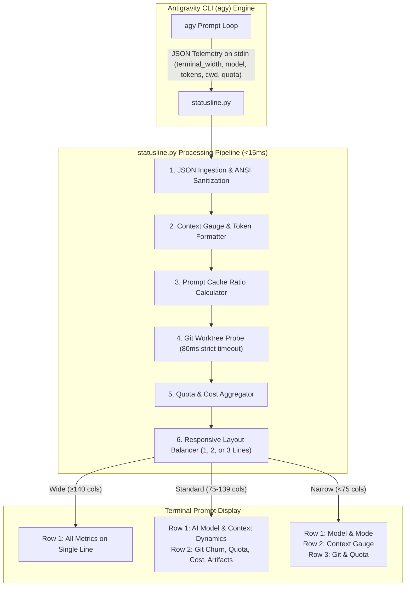

# Component Specification 01: Multi-Line Responsive Developer Statusline (`statusline.py`)
**Component ID:** `agy-statusline`  
**Target Path:** `~/.gemini/config/scripts/statusline.py`  
**Execution Budget:** Sub-15ms ($< 15\text{ ms}$) total wall-clock runtime  
**Terminal Footprint:** Dynamic 1, 2, or 3 lines auto-balanced to `terminal_width`  
**Dependencies:** Python 3.10+ standard library only (`sys`, `os`, `json`, `re`, `subprocess`). Zero external pip packages.

---

## 1. Component Architecture & Telemetry Pipeline

The statusline operates as a high-performance streaming visual gauge positioned directly below the Antigravity (`agy`) chat prompt. It consumes telemetry JSON on `stdin` streamed from the AGY engine on every prompt cycle, computes token dynamics, measures prompt caching ratios, probes git churn safely with micro-timeouts, and outputs color-balanced ANSI lines.



---

## 2. Invariants & Performance Guardrails

1. **Sub-15ms Execution Budget:** The script must never block the interactive typing experience of the developer. No network calls, disk write stalls, or complex imports are permitted.
2. **Git Probe Invariants:**
   - Probing `git rev-parse` and `git diff` must have strict micro-timeouts (`timeout=0.08s` / 80ms) to prevent freezing when working over network filesystems (NFS/SSHFS) or massive monorepos.
   - If not inside a git repository, the git segment is cleanly omitted without error.
3. **Prompt Cache Efficiency Ratio:**
   $$\text{Cache Ratio} = \frac{\text{cache\_read\_input\_tokens}}{\text{cache\_read\_input\_tokens} + \text{input\_tokens}} \times 100\%$$
   Displayed in cyan as `(Cache: XX%)` to provide instant feedback on prompt caching performance.
4. **Visual Context Window Gauge:**
   A 5-block visual density meter `[■■□□□]` color-coded dynamically:
   - Green ($< 60\%$ consumed)
   - Yellow ($60\% - 79\%$ consumed)
   - Red + Alert $\ge 80\%$ consumed (`⚠️ 📊 Ctx: 850k [■■■■□] 81%`)
5. **Zero-Crash Resilience:** All exceptions are caught silently with graceful fallbacks. An empty output is preferred over a broken prompt.

---

## 3. Responsive Layout Matrix

| Terminal Width | Layout Mode | Line 1 Content | Line 2 Content | Line 3 Content |
| :--- | :--- | :--- | :--- | :--- |
| $\ge 140$ columns | **Single Line** | `⚡ Model: 3.8 Flash [AUTO] │ 📊 Ctx: 275k [■□□□□] 20% (Cache: 99%) │ 🌿 Git: main* (+14 -3) │ ⏳ Quota: 92% (5h) │ 💰 Cost: $0.0350 │ 📦 Arts: 4` | *(Omitted)* | *(Omitted)* |
| $75 - 139$ columns | **Two Lines (Balanced)** | `⚡ Model: 3.8 Flash:high [AUTO] │ 📊 Ctx: 275k [■□□□□] 20% (Cache: 99%)` | `🌿 Git: main* (+14 -3) │ ⏳ Quota: 92% (5h) │ 💰 Cost: $0.0350 │ 📦 Arts: 4` | *(Omitted)* |
| $< 75$ columns | **Three Lines (Compact)** | `⚡ Model: 3.8 Flash [AUTO]` | `📊 Ctx: 275k [■□□□□] 20%` | `🌿 Git: main* │ ⏳ Quota: 92%` |

---

## 4. Complete Executable Source Code

Write this file to `~/.gemini/config/scripts/statusline.py` and run `chmod +x ~/.gemini/config/scripts/statusline.py`:

```python
#!/usr/bin/env python3
"""
Antigravity Multi-Line Developer Statusline
Automatically adapts between 1, 2, or 3 lines depending on terminal window width.
When window size cannot fit all metrics on a single line, splits cleanly into logical rows
so all vital metrics and rich labels remain fully visible.
Designed to never crash, auto-fit terminal width, and execute in <15ms.
"""

import sys
import os
import json
import re
import subprocess

def fmt_tokens(n):
    try:
        n = int(n or 0)
    except Exception:
        return "0"
    if n >= 1_000_000:
        return f"{n/1_000_000:.1f}M"
    if n >= 1_000:
        return f"{n/1_000:.1f}k"
    return str(n)

def strip_ansi(text):
    return re.sub(r"\033\[[0-9;]*m", "", text)

def parse_model(val):
    if isinstance(val, str):
        return val
    if isinstance(val, dict):
        return (
            val.get("display_name")
            or val.get("name")
            or val.get("label")
            or val.get("model_id")
            or val.get("id")
            or val.get("title")
            or (next((v for v in val.values() if isinstance(v, str)), "") if val else "")
            or "Gemini"
        )
    return "Gemini"

def parse_effort(effort_val, model_val):
    if isinstance(effort_val, str) and effort_val:
        return effort_val
    if isinstance(model_val, dict):
        eff = model_val.get("effort")
        if isinstance(eff, str) and eff:
            return eff
    return None

def get_git_info(cwd):
    """
    Safely inspects git status in cwd with strict timeouts (<80ms).
    Returns None if cwd is not a git repository.
    """
    if not cwd or not os.path.isdir(cwd):
        return None
    try:
        chk = subprocess.run(
            ["git", "-C", cwd, "rev-parse", "--is-inside-work-tree"],
            capture_output=True, text=True, timeout=0.08
        )
        if chk.returncode != 0 or chk.stdout.strip() != "true":
            return None

        b_res = subprocess.run(
            ["git", "-C", cwd, "rev-parse", "--abbrev-ref", "HEAD"],
            capture_output=True, text=True, timeout=0.08
        )
        branch = b_res.stdout.strip() or "HEAD"
        if branch == "HEAD":
            h_res = subprocess.run(
                ["git", "-C", cwd, "rev-parse", "--short", "HEAD"],
                capture_output=True, text=True, timeout=0.08
            )
            branch = f":{h_res.stdout.strip()}"

        d_res = subprocess.run(
            ["git", "-C", cwd, "diff", "HEAD", "--shortstat"],
            capture_output=True, text=True, timeout=0.08
        )
        diff_out = d_res.stdout.strip()
        if not diff_out and d_res.returncode != 0:
            d_res = subprocess.run(
                ["git", "-C", cwd, "diff", "--shortstat"],
                capture_output=True, text=True, timeout=0.08
            )
            diff_out = d_res.stdout.strip()

        u_res = subprocess.run(
            ["git", "-C", cwd, "status", "--porcelain"],
            capture_output=True, text=True, timeout=0.08
        )
        status_lines = u_res.stdout.strip().splitlines() if u_res.stdout else []
        is_dirty = len(status_lines) > 0
        untracked = sum(1 for l in status_lines if l.startswith("??"))

        ins, dels = 0, 0
        if diff_out:
            m_ins = re.search(r"(\d+) insertion", diff_out)
            m_del = re.search(r"(\d+) deletion", diff_out)
            if m_ins: ins = int(m_ins.group(1))
            if m_del: dels = int(m_del.group(1))

        return {
            "branch": branch,
            "dirty": is_dirty,
            "insertions": ins,
            "deletions": dels,
            "untracked": untracked
        }
    except Exception:
        return None

def main():
    try:
        raw = sys.stdin.read().strip()
        if not raw:
            return

        data = json.loads(raw)
        if not isinstance(data, dict):
            return

        # ANSI Color Palette
        RST = "\033[0m"
        DIM = "\033[2m"
        CYAN = "\033[36m"
        GREEN = "\033[32m"
        YELLOW = "\033[33m"
        MAGENTA = "\033[35m"
        BLUE = "\033[34m"
        RED = "\033[31m"

        try:
            terminal_width = int(data.get("terminal_width") or 80)
        except Exception:
            terminal_width = 80

        # Model & Mode
        raw_model = data.get("model")
        model_name = parse_model(raw_model)
        clean_model = (
            model_name.replace("Gemini ", "")
            .replace(" (High)", "")
            .replace(" (Medium)", "")
            .replace(" (Low)", "")
            .strip()
        )
        if not clean_model:
            clean_model = "Gemini"

        effort = parse_effort(data.get("effort"), raw_model)
        raw_mode = data.get("editorMode") or data.get("agent_state") or "auto"
        mode = (raw_mode if isinstance(raw_mode, str) else "auto").upper()

        model_str = f"{CYAN}⚡ Model: {clean_model}{RST}"
        if effort:
            model_str += f"{DIM}:{effort}{RST}"
        model_str += f" {DIM}[{mode}]{RST}"

        # Context Window Dynamics
        cw = data.get("context_window") or {}
        total_in = cw.get("total_input_tokens") or 0
        total_out = cw.get("total_output_tokens") or 0
        total_tok = (total_in + total_out) if (total_in or total_out) else (data.get("total_tokens") or 0)
        max_size = cw.get("context_window_size") or 1048576

        used_pct = cw.get("used_percentage")
        if used_pct is not None:
            pct = float(used_pct)
        elif max_size > 0 and total_tok > 0:
            pct = (total_tok / max_size) * 100.0
        else:
            pct = 0.0

        bar_len = 5
        filled = min(bar_len, max(0, round(pct / 100.0 * bar_len)))
        bar = "■" * filled + "□" * (bar_len - filled)

        if pct >= 80.0:
            ctx_color = RED
            alert = "⚠️ "
        elif pct >= 60.0:
            ctx_color = YELLOW
            alert = ""
        else:
            ctx_color = GREEN
            alert = ""

        ctx_str = f"{ctx_color}{alert}📊 Ctx: {fmt_tokens(total_tok)} [{bar}] {pct:.0f}%{RST}"

        # Prompt Cache Efficiency
        cur_usage = cw.get("current_usage") or {}
        cache_read = cur_usage.get("cache_read_input_tokens") or 0
        cur_in = cur_usage.get("input_tokens") or 0
        if cache_read > 0 and (cache_read + cur_in) > 0:
            cache_pct = (cache_read / (cache_read + cur_in)) * 100.0
            ctx_str += f" {CYAN}(Cache: {cache_pct:.0f}%){RST}"

        # Pending Tool Confirmation Alert
        tool_pending_str = None
        if data.get("tool_confirmation_pending"):
            tool_pending_str = f"{YELLOW}🔔 Waiting: Tool Approval{RST}"

        # Git Status
        cwd = data.get("cwd") or (data.get("workspace") or {}).get("current_dir") or os.getcwd()
        git_info = get_git_info(cwd)
        git_str = None
        if git_info:
            branch = git_info["branch"]
            dirty = git_info["dirty"]
            ins = git_info["insertions"]
            dels = git_info["deletions"]
            untracked = git_info["untracked"]

            dirty_flag = "*" if dirty else ""
            branch_color = YELLOW if dirty else MAGENTA
            git_str = f"{branch_color}🌿 Git: {branch}{dirty_flag}{RST}"

            churn_elements = []
            if ins > 0: churn_elements.append(f"{GREEN}+{ins}{RST}")
            if dels > 0: churn_elements.append(f"{RED}-{dels}{RST}")
            if not churn_elements and untracked > 0: churn_elements.append(f"{YELLOW}?{untracked}{RST}")

            if churn_elements:
                git_str += f" (Diff: {' '.join(churn_elements)})"

        # Quota Tracking
        quota_str = None
        quota = data.get("quota")
        if isinstance(quota, dict):
            g5h = quota.get("gemini-5h")
            if isinstance(g5h, dict) and "remaining_fraction" in g5h:
                pct_quota = int(round(g5h["remaining_fraction"] * 100))
                quota_str = f"{GREEN}⏳ Quota: {pct_quota}% (5h){RST}"
        elif isinstance(quota, list):
            for bucket in quota:
                if isinstance(bucket, dict):
                    p = bucket.get("percentage_remaining") or bucket.get("remaining")
                    name = str(bucket.get("display_name") or bucket.get("name") or "")
                    if p is not None and ("5" in name or "five" in name.lower()):
                        quota_str = f"{GREEN}⏳ Quota: {int(round(p))}% (5h){RST}"
                        break

        # Cost & Spend
        spend_str = None
        try:
            total_usd = float(data.get("total_usd") or 0.0)
            sub_usd = float(data.get("subagent_usd") or 0.0)
            if total_usd > 0:
                spend_str = f"{YELLOW}💰 Cost: ${total_usd:.4f}{RST}"
                if sub_usd > 0 and terminal_width > 90:
                    spend_str += f"{DIM} (sub: ${sub_usd:.3f}){RST}"
        except Exception:
            pass

        # Artifacts Count
        art_str = None
        try:
            artifacts = int(data.get("artifact_count") or 0)
            if artifacts > 0:
                art_str = f"{BLUE}📦 Arts: {artifacts}{RST}"
        except Exception:
            pass

        # Running Subagents
        subagent_str = None
        try:
            subagents = data.get("subagents")
            cnt = len(subagents) if isinstance(subagents, list) else (subagents if isinstance(subagents, int) else 0)
            if cnt > 0:
                subagent_str = f"{MAGENTA}🤖 Agents: {cnt}{RST}"
        except Exception:
            pass

        # Step Count
        step_str = None
        try:
            step = int(data.get("step_count") or 0)
            if step > 0:
                step_str = f"{DIM}Turn: {step}{RST}"
        except Exception:
            pass

        sep = f" {DIM}│{RST} "

        # Layout Balancer
        row1_items = [x for x in [model_str, ctx_str] if x]
        row2_items = [x for x in [git_str, quota_str, tool_pending_str, spend_str, art_str, subagent_str, step_str] if x]
        all_items = row1_items + row2_items

        # Check Single Line
        single_line = sep.join(all_items)
        if len(strip_ansi(single_line)) <= terminal_width:
            print(single_line)
            return

        # Check Two Balanced Lines
        r1_rendered = sep.join(row1_items)
        r2_rendered = sep.join(row2_items)
        if len(strip_ansi(r1_rendered)) <= terminal_width and len(strip_ansi(r2_rendered)) <= terminal_width:
            print(r1_rendered)
            print(r2_rendered)
            return

        # Pack Greedily across 2-3 lines
        lines = []
        curr_line = []
        for it in all_items:
            test_line = curr_line + [it]
            rendered = sep.join(test_line)
            if len(strip_ansi(rendered)) <= terminal_width:
                curr_line.append(it)
            else:
                if curr_line:
                    lines.append(sep.join(curr_line))
                    curr_line = [it]
                else:
                    lines.append(it)
                    curr_line = []
        if curr_line:
            lines.append(sep.join(curr_line))

        print("\n".join(lines[:3]))

    except Exception:
        return

if __name__ == "__main__":
    try:
        main()
    except Exception:
        sys.exit(0)
```

---

## 5. Verification & Performance Benchmark

Execute the automated test script to verify formatting and confirm runtime is $< 15\text{ ms}$:

```bash
python3 -c '
import subprocess, json, time

payload = json.dumps({
    "terminal_width": 120,
    "model": "Gemini 3.8 Flash (High)",
    "effort": "high",
    "editorMode": "auto",
    "total_tokens": 284000,
    "context_window": {
        "context_window_size": 1048576,
        "used_percentage": 27.1,
        "current_usage": {"cache_read_input_tokens": 210000, "input_tokens": 74000}
    },
    "quota": {"gemini-5h": {"remaining_fraction": 0.94}},
    "total_usd": 0.0420,
    "artifact_count": 3
})

t0 = time.time()
res = subprocess.run(
    ["python3", os.path.expanduser("~/.gemini/config/scripts/statusline.py")],
    input=payload, text=True, capture_output=True
)
t1 = time.time()
elapsed_ms = (t1 - t0) * 1000

assert res.returncode == 0, "Non-zero exit code"
assert "3.8 Flash" in res.stdout, "Missing model string"
assert "Ctx:" in res.stdout, "Missing context gauge"
assert "Cache: 74%" in res.stdout, "Missing cache ratio calculation"
print(f"Statusline Verification: PASSED ✅ ({elapsed_ms:.2f}ms runtime)")
'
```
