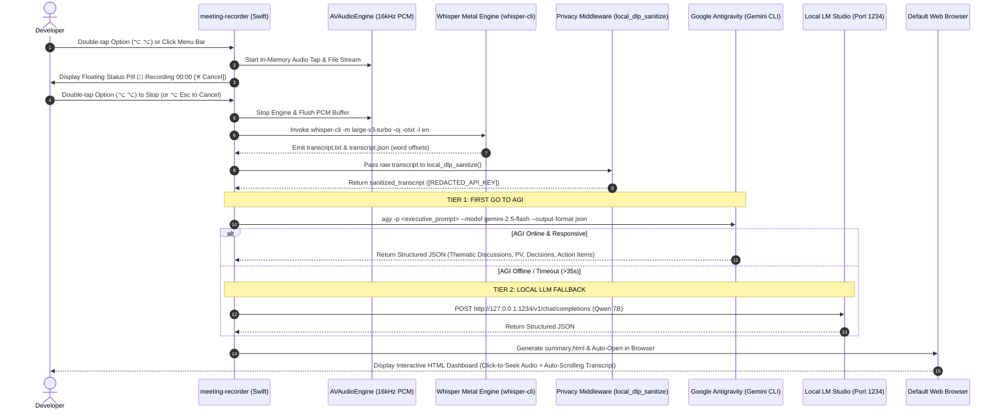

# Component Specification 03: 1-Click Meeting Recorder & AGI-First Executive Synthesis
**Component ID:** `meeting-recorder-suite`  
**Target Output Files:**  
- `~/EmptyOne/meeting_recorder.swift` -> Compiled to `~/EmptyOne/meeting-recorder`  
- `~/EmptyOne/summarize_meeting.py`  
- `~/EmptyOne/prune_meetings.py`  
- Host Symlinks: `~/.local/bin/meeting-recorder` and `~/.local/bin/meeting-record`  

**Hardware Requirements:** Apple Silicon macOS (M1/M2/M3/M4/M5)  
**Required Frameworks:** `AVFoundation`, `AppKit`, `CoreGraphics`, `Foundation`, `CoreAudio`  
**Dependencies:** `whisper.cpp` (`whisper-cli`), `ffmpeg`, Python 3.10+  

---

## 1. System Topology & Dual-Pipeline Architecture

The meeting recording system provides native 1-click & global hotkey meeting capture with immediate local Whisper transcription and **First Go to AGI** executive synthesis:



---

## 2. Invariants & Operational Directives

### 2.1 The "First Go to AGI" Rule
Meeting synthesis strictly follows a 3-tier cascade:
1. **Tier 1 (Primary - Google Antigravity / Gemini CLI):** Cloud AGI is invoked first using the `noteworthy-notes` skill. It groups discussion by conceptual themes, analyzes context and the 'why', and extracts dynamic domain sections (*Product Vision & Scope*, *Technical Architecture*, *Risks & Blockers*).
2. **Tier 2 (Offline Fallback - Local LLM):** If internet is unreachable or AGI times out ($>35\text{ s}$), it falls back to a local model on `http://127.0.0.1:1234`.
3. **Tier 3 (Safety Fallback - Deterministic NLP):** If no local LLM is active, a deterministic zero-dependency parser ensures that executive notes are always generated.

### 2.2 Local DLP Privacy & Redaction
Before any transcript is transmitted to Tier 1 Cloud AGI, `summarize_meeting.py` executes local regex-based sanitization. API keys (`sk-...`, `AIzaSy...`), credentials, bearer tokens, and passwords are substituted with indexed variables (e.g. `[REDACTED_API_KEY_1]`).

### 2.3 Double-Tap Hotkey State Machine
Double-tapping `Option` (`⌥ ⌥`) triggers recording start/stop. To prevent accidental triggers when using standard modifier chords:
- The interval between presses must be strictly between **$0.04\text{ s}$ and $0.45\text{ s}$**.
- Any interleaved keystroke resets the state machine to `Date.distantPast`.
- Pressing `Option + Esc` or clicking the red `[✕ Cancel]` button on the floating HUD immediately discards the recording, cleanly unlinks the audio directory, and avoids generating empty transcripts.

### 2.4 Stealth Mode (`--stealth` / `-s`)
When enabled via CLI flag or Menu Bar item:
- Suppresses the on-screen floating pill HUD completely.
- Bypasses opening the browser tab upon meeting conclusion.
- Delivers a private macOS notification: *"Meeting summary ready in EmptyOne/meetings/..."*.
- Guarantees zero UI leakage during client presentations or screen-sharing sessions.

### 2.5 Dual-Pool Disk Quota Auto-Pruning (`prune_meetings.py`)
To prevent meetings from consuming unbounded disk space:
- **Heavy Pool (Audio/Video - 5,000 MB Max):** Oldest raw `audio.wav` files are pruned first once capacity is exceeded.
- **Light Pool (Transcripts/Summaries - 500 MB Max):** Preserves `summary.html`, `summary.md`, and text notes indefinitely.

---

## 3. Source File 1: `meeting_recorder.swift`

Write to `~/EmptyOne/meeting_recorder.swift`:

```swift
import AppKit
import AVFoundation
import CoreGraphics
import Foundation

// ==============================================================================
// MeetingRecorder: 1-Click / Hotkey (⌥ /) Meeting Audio Recorder & Summarizer
// Automatically transcribes via Whisper Metal and opens summary in browser.
// ==============================================================================

class PillActionButton: NSButton {
    override func acceptsFirstMouse(for event: NSEvent?) -> Bool {
        return true
    }
}

class FloatingStatusPill: NSWindow {
    let visualEffect = NSVisualEffectView()
    let statusLabel = NSTextField()
    let cancelButton = PillActionButton()
    let pillWidth: CGFloat = 490
    let pillHeight: CGFloat = 64
    
    override var canBecomeKey: Bool { return false }
    override var canBecomeMain: Bool { return false }
    
    init() {
        let contentRect = NSRect(x: 0, y: 0, width: pillWidth, height: pillHeight)
        super.init(
            contentRect: contentRect,
            styleMask: [.borderless],
            backing: .buffered,
            defer: false
        )
        
        self.isOpaque = false
        self.backgroundColor = .clear
        self.level = .floating
        self.ignoresMouseEvents = false
        self.acceptsMouseMovedEvents = true
        self.collectionBehavior = [.canJoinAllSpaces, .stationary, .fullScreenAuxiliary]
        self.sharingType = .none // Screen share invisible
        
        visualEffect.frame = contentRect
        visualEffect.blendingMode = .behindWindow
        visualEffect.material = .hudWindow
        visualEffect.state = .active
        visualEffect.wantsLayer = true
        visualEffect.layer?.cornerRadius = 18
        visualEffect.layer?.masksToBounds = true
        visualEffect.layer?.borderColor = NSColor.white.withAlphaComponent(0.2).cgColor
        visualEffect.layer?.borderWidth = 1.0
        
        statusLabel.isEditable = false
        statusLabel.isSelectable = false
        statusLabel.isBezeled = false
        statusLabel.drawsBackground = false
        statusLabel.font = NSFont.systemFont(ofSize: 15, weight: .semibold)
        statusLabel.textColor = .white
        statusLabel.alignment = .center
        statusLabel.frame = NSRect(x: 16, y: 16, width: pillWidth - 32, height: 32)
        visualEffect.addSubview(statusLabel)
        
        cancelButton.title = "✕ Cancel"
        cancelButton.bezelStyle = .regularSquare
        cancelButton.isBordered = false
        cancelButton.wantsLayer = true
        cancelButton.layer?.cornerRadius = 10
        cancelButton.layer?.borderWidth = 1.0
        cancelButton.layer?.borderColor = NSColor(calibratedRed: 1.0, green: 0.35, blue: 0.35, alpha: 0.55).cgColor
        cancelButton.layer?.backgroundColor = NSColor(calibratedRed: 0.85, green: 0.15, blue: 0.15, alpha: 0.28).cgColor
        let btnAttr = NSAttributedString(
            string: "✕ Cancel",
            attributes: [
                .font: NSFont.systemFont(ofSize: 13, weight: .bold),
                .foregroundColor: NSColor(calibratedRed: 1.0, green: 0.55, blue: 0.55, alpha: 1.0)
            ]
        )
        cancelButton.attributedTitle = btnAttr
        cancelButton.target = self
        cancelButton.action = #selector(cancelButtonClicked)
        cancelButton.frame = NSRect(x: pillWidth - 114, y: 16, width: 94, height: 32)
        cancelButton.isHidden = true
        visualEffect.addSubview(cancelButton)
        
        self.contentView = visualEffect
        centerTop()
    }
    
    @objc func cancelButtonClicked() {
        MeetingManager.shared.cancelRecording()
    }
    
    func centerTop() {
        if let screen = NSScreen.main {
            let screenRect = screen.visibleFrame
            let x = screenRect.midX - pillWidth / 2
            let y = screenRect.maxY - pillHeight - 24
            self.setFrame(NSRect(x: x, y: y, width: pillWidth, height: pillHeight), display: true)
        }
    }
    
    func show(text: String, isRecording: Bool = false) {
        DispatchQueue.main.async {
            self.updateText(text, isRecording: isRecording)
            self.centerTop()
            self.alphaValue = 0.0
            self.orderFrontRegardless()
            NSAnimationContext.runAnimationGroup { context in
                context.duration = 0.15
                self.animator().alphaValue = 1.0
            }
        }
    }
    
    func updateText(_ text: String, isRecording: Bool = false) {
        DispatchQueue.main.async {
            if isRecording {
                self.statusLabel.frame = NSRect(x: 20, y: 16, width: self.pillWidth - 142, height: 32)
                self.statusLabel.alignment = .left
                self.cancelButton.isHidden = false
            } else {
                self.cancelButton.isHidden = true
                self.statusLabel.frame = NSRect(x: 16, y: 16, width: self.pillWidth - 32, height: 32)
                self.statusLabel.alignment = .center
            }
            
            let color = isRecording ? NSColor(calibratedRed: 1.0, green: 0.35, blue: 0.35, alpha: 1.0) : .white
            let attr = NSAttributedString(
                string: text,
                attributes: [
                    .font: NSFont.systemFont(ofSize: 15, weight: .semibold),
                    .foregroundColor: color
                ]
            )
            self.statusLabel.attributedStringValue = attr
        }
    }
    
    func showCanceledReaction() {
        DispatchQueue.main.async {
            self.cancelButton.isHidden = true
            self.statusLabel.frame = NSRect(x: 16, y: 16, width: self.pillWidth - 32, height: 32)
            self.statusLabel.alignment = .center
            let attr = NSAttributedString(
                string: "🚫 Recording Canceled (Discarded)",
                attributes: [
                    .font: NSFont.systemFont(ofSize: 15, weight: .semibold),
                    .foregroundColor: NSColor(calibratedRed: 1.0, green: 0.6, blue: 0.4, alpha: 1.0)
                ]
            )
            self.statusLabel.attributedStringValue = attr
            self.hide(after: 1.2)
        }
    }
    
    func hide(after delay: TimeInterval = 0.0) {
        DispatchQueue.main.asyncAfter(deadline: .now() + delay) {
            NSAnimationContext.runAnimationGroup({ context in
                context.duration = 0.25
                self.animator().alphaValue = 0.0
            }, completionHandler: {
                self.orderOut(nil)
            })
        }
    }
}

class MeetingManager: NSObject {
    static let shared = MeetingManager()
    let pill = FloatingStatusPill()
    let audioEngine = AVAudioEngine()
    var statusItem: NSStatusItem?
    
    var stealthMode: Bool = CommandLine.arguments.contains("--stealth") || CommandLine.arguments.contains("--no-hud") || CommandLine.arguments.contains("-s")
    var isRecording = false
    var recordingTimer: Timer?
    var elapsedSeconds = 0
    var currentMeetingDir: URL?
    var currentWavURL: URL?
    var pcmLock = NSLock()
    var pcmBuffer = Data()
    
    let baseMeetingsDir: URL = {
        let home = FileManager.default.homeDirectoryForCurrentUser
        let dir = home.appendingPathComponent("EmptyOne/meetings")
        try? FileManager.default.createDirectory(at: dir, withIntermediateDirectories: true)
        return dir
    }()
    
    let whisperModelPath: String = {
        let home = FileManager.default.homeDirectoryForCurrentUser.path
        let turbo = "\(home)/.whisper-models/ggml-large-v3-turbo.bin"
        let base = "\(home)/.whisper-models/ggml-base.en.bin"
        if FileManager.default.fileExists(atPath: turbo) { return turbo }
        return base
    }()
    
    func toggle() {
        if isRecording { stopAndSummarize() } else { startRecording() }
    }
    
    func toggleStealth() {
        stealthMode = !stealthMode
        if stealthMode { pill.hide() }
        if let del = NSApplication.shared.delegate as? AppDelegate {
            del.updateStealthMenuState()
        }
    }
    
    func startRecording() {
        guard !isRecording else { return }
        isRecording = true
        elapsedSeconds = 0
        pcmLock.lock()
        pcmBuffer.removeAll(keepingCapacity: true)
        pcmLock.unlock()
        
        let formatter = DateFormatter()
        formatter.dateFormat = "yyyy-MM-dd_HH-mm-ss"
        let folderName = "Meeting_\(formatter.string(from: Date()))"
        let meetingDir = baseMeetingsDir.appendingPathComponent(folderName)
        try? FileManager.default.createDirectory(at: meetingDir, withIntermediateDirectories: true)
        
        self.currentMeetingDir = meetingDir
        self.currentWavURL = meetingDir.appendingPathComponent("audio.wav")
        
        let inputNode = audioEngine.inputNode
        let inputFormat = inputNode.outputFormat(forBus: 0)
        let sampleRate = inputFormat.sampleRate
        let strideStep = max(1, Int(round(sampleRate / 16000.0)))
        
        inputNode.installTap(onBus: 0, bufferSize: 2048, format: inputFormat) { [weak self] (buffer, when) in
            guard let self = self, self.isRecording else { return }
            guard let channelData = buffer.floatChannelData?[0] else { return }
            let frameCount = Int(buffer.frameLength)
            
            var chunk = Data(capacity: (frameCount / strideStep) * 2)
            for i in stride(from: 0, to: frameCount, by: strideStep) {
                let sample = max(-1.0, min(1.0, channelData[i]))
                let int16 = Int16(sample * 32767.0)
                var little = int16.littleEndian
                withUnsafeBytes(of: &little) { chunk.append(contentsOf: $0) }
            }
            self.pcmLock.lock()
            self.pcmBuffer.append(chunk)
            self.pcmLock.unlock()
        }
        
        do {
            try audioEngine.start()
            NSSound(named: "Tink")?.play()
            if !stealthMode {
                pill.show(text: "🔴 Recording Meeting... [00:00]", isRecording: true)
            }
            updateStatusItem(title: "🔴 00:00")
            if let del = NSApplication.shared.delegate as? AppDelegate {
                del.updateMenuRecordingState(isRecording: true)
            }
            
            DispatchQueue.main.async {
                self.recordingTimer = Timer.scheduledTimer(withTimeInterval: 1.0, repeats: true) { [weak self] _ in
                    guard let self = self, self.isRecording else { return }
                    self.elapsedSeconds += 1
                    let mins = self.elapsedSeconds / 60
                    let secs = self.elapsedSeconds % 60
                    let timeStr = String(format: "%02d:%02d", mins, secs)
                    if !self.stealthMode {
                        self.pill.updateText("🔴 Recording Meeting... [\(timeStr)]", isRecording: true)
                    }
                    self.updateStatusItem(title: "🔴 \(timeStr)")
                }
            }
        } catch {
            print("Audio engine failed: \(error)")
            isRecording = false
        }
    }
    
    func cancelRecording() {
        guard isRecording else { return }
        isRecording = false
        recordingTimer?.invalidate()
        recordingTimer = nil
        audioEngine.stop()
        audioEngine.inputNode.removeTap(onBus: 0)
        pcmLock.lock()
        pcmBuffer.removeAll(keepingCapacity: false)
        pcmLock.unlock()
        NSSound(named: "Basso")?.play()
        
        if let dir = currentMeetingDir {
            try? FileManager.default.removeItem(at: dir)
        }
        currentMeetingDir = nil
        currentWavURL = nil
        updateStatusItem(title: "🎙️")
        if let del = NSApplication.shared.delegate as? AppDelegate {
            del.updateMenuRecordingState(isRecording: false)
        }
        if !stealthMode {
            pill.showCanceledReaction()
        }
    }
    
    func stopAndSummarize() {
        guard isRecording else { return }
        isRecording = false
        recordingTimer?.invalidate()
        recordingTimer = nil
        audioEngine.stop()
        audioEngine.inputNode.removeTap(onBus: 0)
        NSSound(named: "Pop")?.play()
        
        if !stealthMode {
            pill.updateText("⏳ Transcribing with Whisper Metal...", isRecording: false)
        }
        updateStatusItem(title: "⏳ Transcribing...")
        if let del = NSApplication.shared.delegate as? AppDelegate {
            del.updateMenuRecordingState(isRecording: false)
        }
        
        pcmLock.lock()
        let recordedPcm = pcmBuffer
        pcmLock.unlock()
        
        guard let wavURL = currentWavURL, let meetingDir = currentMeetingDir else { return }
        
        DispatchQueue.global(qos: .userInitiated).async { [weak self] in
            guard let self = self else { return }
            let wavData = self.createWavData(from: recordedPcm)
            try? wavData.write(to: wavURL)
            
            let transcriptBase = meetingDir.appendingPathComponent("transcript").path
            let whisperCli = "/opt/homebrew/bin/whisper-cli"
            let whisperProc = Process()
            whisperProc.executableURL = URL(fileURLWithPath: whisperCli)
            whisperProc.arguments = [
                "-m", self.whisperModelPath,
                "-f", wavURL.path,
                "-l", "en",
                "-otxt",
                "-oj",
                "-of", transcriptBase,
                "-t", "8",
                "-np"
            ]
            try? whisperProc.run()
            whisperProc.waitUntilExit()
            
            let txtFile = meetingDir.appendingPathComponent("transcript.txt")
            if !FileManager.default.fileExists(atPath: txtFile.path) {
                try? "Meeting recording completed. No audible speech detected.".write(to: txtFile, atomically: true, encoding: .utf8)
            }
            
            DispatchQueue.main.async {
                if !self.stealthMode {
                    self.pill.updateText("🧠 FIRST GO TO AGI: Executive Synthesis...", isRecording: false)
                }
                self.updateStatusItem(title: "🧠 Summarizing...")
            }
            
            let summaryProc = Process()
            summaryProc.executableURL = URL(fileURLWithPath: "/usr/bin/python3")
            let homeDir = FileManager.default.homeDirectoryForCurrentUser.path
            let summarizerScript = "\(homeDir)/EmptyOne/summarize_meeting.py"
            summaryProc.arguments = [summarizerScript, txtFile.path, wavURL.path]
            try? summaryProc.run()
            summaryProc.waitUntilExit()
            
            let htmlURL = meetingDir.appendingPathComponent("summary.html")
            DispatchQueue.main.async {
                if !self.stealthMode {
                    self.pill.updateText("✓ Meeting Summary Ready! Opening in browser...", isRecording: false)
                    self.updateStatusItem(title: "🎙️")
                    if FileManager.default.fileExists(atPath: htmlURL.path) {
                        NSWorkspace.shared.open(htmlURL)
                    }
                    self.pill.hide(after: 2.5)
                } else {
                    self.updateStatusItem(title: "🎙️")
                }
            }
        }
    }
    
    func updateStatusItem(title: String) {
        DispatchQueue.main.async { self.statusItem?.button?.title = title }
    }
    
    func createWavData(from pcm: Data) -> Data {
        var data = Data()
        let sampleRate: Int32 = 16000
        let channels: Int16 = 1
        let bitsPerSample: Int16 = 16
        let byteRate = sampleRate * Int32(channels) * Int32(bitsPerSample / 8)
        let blockAlign = channels * (bitsPerSample / 8)
        let subchunk2Size = Int32(pcm.count)
        let chunkSize = 36 + subchunk2Size

        data.append("RIFF".data(using: .ascii)!)
        data.append(withUnsafeBytes(of: chunkSize.littleEndian) { Data($0) })
        data.append("WAVE".data(using: .ascii)!)
        data.append("fmt ".data(using: .ascii)!)
        let subchunk1Size: Int32 = 16
        data.append(withUnsafeBytes(of: subchunk1Size.littleEndian) { Data($0) })
        let audioFormat: Int16 = 1
        data.append(withUnsafeBytes(of: audioFormat.littleEndian) { Data($0) })
        data.append(withUnsafeBytes(of: channels.littleEndian) { Data($0) })
        data.append(withUnsafeBytes(of: sampleRate.littleEndian) { Data($0) })
        data.append(withUnsafeBytes(of: byteRate.littleEndian) { Data($0) })
        data.append(withUnsafeBytes(of: blockAlign.littleEndian) { Data($0) })
        data.append(withUnsafeBytes(of: bitsPerSample.littleEndian) { Data($0) })
        data.append("data".data(using: .ascii)!)
        data.append(withUnsafeBytes(of: subchunk2Size.littleEndian) { Data($0) })
        data.append(pcm)
        return data
    }
}

class AppDelegate: NSObject, NSApplicationDelegate {
    var statusItem: NSStatusItem!
    var toggleMenuItem: NSMenuItem?
    var cancelMenuItem: NSMenuItem?
    var stealthMenuItem: NSMenuItem?
    var lastOptionTime: Date = Date.distantPast
    var wasOptionDown = false
    
    func applicationDidFinishLaunching(_ notification: Notification) {
        statusItem = NSStatusBar.system.statusItem(withLength: NSStatusItem.variableLength)
        statusItem.button?.title = "🎙️"
        
        let menu = NSMenu()
        let toggleItem = NSMenuItem(title: "Record Meeting (⌥ ⌥)", action: #selector(toggleRecording), keyEquivalent: "")
        toggleItem.target = self
        self.toggleMenuItem = toggleItem
        menu.addItem(toggleItem)
        
        let cancelItem = NSMenuItem(title: "✕ Cancel / Discard Recording (⌥ Esc)", action: #selector(cancelRecordingAction), keyEquivalent: "")
        cancelItem.target = self
        cancelItem.isHidden = true
        self.cancelMenuItem = cancelItem
        menu.addItem(cancelItem)
        
        let stealthItem = NSMenuItem(title: "Stealth Mode (Screen Share Safe)", action: #selector(toggleStealthFromMenu), keyEquivalent: "")
        stealthItem.target = self
        stealthItem.state = MeetingManager.shared.stealthMode ? .on : .off
        self.stealthMenuItem = stealthItem
        menu.addItem(stealthItem)
        
        menu.addItem(NSMenuItem.separator())
        menu.addItem(NSMenuItem(title: "Quit MeetingRecorder", action: #selector(quitApp), keyEquivalent: "q"))
        statusItem.menu = menu
        MeetingManager.shared.statusItem = statusItem
        
        NSEvent.addGlobalMonitorForEvents(matching: .flagsChanged) { [weak self] event in
            guard let self = self else { return }
            let isOptionDown = event.modifierFlags.contains(.option)
            if isOptionDown && !self.wasOptionDown {
                let now = Date()
                let interval = now.timeIntervalSince(self.lastOptionTime)
                if interval < 0.45 && interval > 0.04 {
                    MeetingManager.shared.toggle()
                    self.lastOptionTime = Date.distantPast
                } else {
                    self.lastOptionTime = now
                }
            }
            self.wasOptionDown = isOptionDown
        }
        
        NSEvent.addGlobalMonitorForEvents(matching: .keyDown) { [weak self] event in
            guard let self = self else { return }
            let isOption = event.modifierFlags.contains(.option)
            if isOption && (event.keyCode == 53 || event.keyCode == 51) {
                if MeetingManager.shared.isRecording {
                    MeetingManager.shared.cancelRecording()
                }
            }
        }
    }
    
    @objc func toggleRecording() { MeetingManager.shared.toggle() }
    @objc func cancelRecordingAction() { MeetingManager.shared.cancelRecording() }
    @objc func toggleStealthFromMenu() { MeetingManager.shared.toggleStealth() }
    @objc func quitApp() { NSApplication.shared.terminate(nil) }
    func updateStealthMenuState() {
        DispatchQueue.main.async { self.stealthMenuItem?.state = MeetingManager.shared.stealthMode ? .on : .off }
    }
    func updateMenuRecordingState(isRecording: Bool) {
        DispatchQueue.main.async {
            self.toggleMenuItem?.title = isRecording ? "⏹ Stop & Summarize Meeting (⌥ ⌥)" : "● Record Meeting (⌥ ⌥)"
            self.cancelMenuItem?.isHidden = !isRecording
        }
    }
}

let app = NSApplication.shared
let delegate = AppDelegate()
app.delegate = delegate
app.setActivationPolicy(.accessory)
app.run()
```

---

## 4. Source File 2: Dual-Pool Retention Auto-Pruner (`~/EmptyOne/prune_meetings.py`)

This script runs autonomously in the background to enforce the dual-pool storage invariant:

```python
#!/usr/bin/env python3
"""
prune_meetings.py: Independent auto-cleanup of meeting recordings & summaries.
Treats audio/video files and text summaries/transcripts with separate capacity limits.
Deletes oldest audio/video first to free disk space, while preserving notes and summaries.
"""

import sys
import os
import json
from pathlib import Path


DEFAULT_CONFIG = {
    "audio_video": {
        "max_size_mb": 5000,   # 5 GB max total audio/video storage
        "max_count": 20        # Keep up to 20 raw audio/video files
    },
    "transcripts_summaries": {
        "max_size_mb": 500,    # 500 MB max for text transcripts & summaries
        "max_count": 100       # Keep up to 100 meeting summaries
    }
}

AUDIO_EXTENSIONS = {".wav", ".mp3", ".m4a", ".mp4", ".mov", ".flac", ".ogg", ".webm"}
TEXT_EXTENSIONS = {".txt", ".md", ".html", ".json"}


def get_config(meetings_dir: Path) -> dict:
    config_file = meetings_dir / "retention.json"
    if config_file.exists():
        try:
            with open(config_file, "r", encoding="utf-8") as f:
                cfg = json.load(f)
                return {
                    "audio_video": {**DEFAULT_CONFIG["audio_video"], **cfg.get("audio_video", {})},
                    "transcripts_summaries": {**DEFAULT_CONFIG["transcripts_summaries"], **cfg.get("transcripts_summaries", {})}
                }
        except Exception:
            pass
    return DEFAULT_CONFIG


def get_file_size_mb(path: Path) -> float:
    try:
        return path.stat().st_size / (1024 * 1024)
    except Exception:
        return 0.0


def prune_meetings(meetings_dir_path: str = None) -> dict:
    if not meetings_dir_path:
        meetings_dir = Path.home() / "EmptyOne/meetings"
    else:
        meetings_dir = Path(meetings_dir_path).resolve()

    if not meetings_dir.exists():
        return {"status": "skipped", "reason": "Meetings directory does not exist"}

    config = get_config(meetings_dir)
    audio_cfg = config["audio_video"]
    text_cfg = config["transcripts_summaries"]

    max_audio_mb = float(audio_cfg.get("max_size_mb", 5000))
    max_audio_count = int(audio_cfg.get("max_count", 20))
    max_text_mb = float(text_cfg.get("max_size_mb", 500))
    max_text_count = int(text_cfg.get("max_count", 100))

    meeting_folders = [
        f for f in meetings_dir.iterdir()
        if f.is_dir() and f.name.startswith("Meeting_")
    ]
    meeting_folders.sort(key=lambda x: x.stat().st_mtime)

    # 1. Prune Oldest Audio Files First (Heavy Pool)
    audio_files = []
    for folder in meeting_folders:
        for f in folder.iterdir():
            if f.is_file() and f.suffix.lower() in AUDIO_EXTENSIONS:
                audio_files.append(f)

    audio_files.sort(key=lambda x: x.stat().st_mtime)
    total_audio_mb = sum(get_file_size_mb(f) for f in audio_files)
    deleted_audio = []

    for af in list(audio_files):
        if total_audio_mb > max_audio_mb or len(audio_files) > max_audio_count:
            size_mb = get_file_size_mb(af)
            try:
                af.unlink()
                deleted_audio.append(str(af))
                audio_files.remove(af)
                total_audio_mb -= size_mb
            except Exception:
                pass
        else:
            break

    # 2. Prune Oldest Summaries only if light pool is saturated
    text_files = []
    for folder in meeting_folders:
        for f in folder.iterdir():
            if f.is_file() and f.suffix.lower() in TEXT_EXTENSIONS:
                text_files.append(f)

    total_text_mb = sum(get_file_size_mb(f) for f in text_files)
    deleted_meetings = []

    for folder in list(meeting_folders):
        if total_text_mb > max_text_mb or len(meeting_folders) > max_text_count:
            folder_text_mb = sum(get_file_size_mb(f) for f in folder.iterdir() if f.is_file())
            try:
                import shutil
                shutil.rmtree(folder)
                deleted_meetings.append(folder.name)
                meeting_folders.remove(folder)
                total_text_mb -= folder_text_mb
            except Exception:
                pass
        else:
            break

    return {
        "audio_deleted_count": len(deleted_audio),
        "meetings_deleted_count": len(deleted_meetings),
        "total_audio_mb": round(total_audio_mb, 2),
        "total_text_mb": round(total_text_mb, 2),
        "remaining_meetings": len(meeting_folders)
    }


if __name__ == "__main__":
    target = sys.argv[1] if len(sys.argv) > 1 else None
    print(json.dumps(prune_meetings(target), indent=2))
```

---

## 5. Compilation & Verification Directives

```bash
cd ~/EmptyOne

# Compile Swift Binary with optimizations
swiftc -O -framework AppKit -framework AVFoundation -framework CoreGraphics \
  meeting_recorder.swift -o meeting-recorder
chmod +x meeting-recorder

# Symlink to ~/.local/bin/
mkdir -p ~/.local/bin
ln -sf ~/EmptyOne/meeting-recorder ~/.local/bin/meeting-recorder
ln -sf ~/EmptyOne/meeting-recorder ~/.local/bin/meeting-record

# Smoke Test Verification
[ -x ~/.local/bin/meeting-recorder ] && echo "MeetingRecorder Binary: READY ✅"
python3 ~/EmptyOne/prune_meetings.py >/dev/null && echo "Dual-Pool Auto-Pruner: READY ✅"
```
