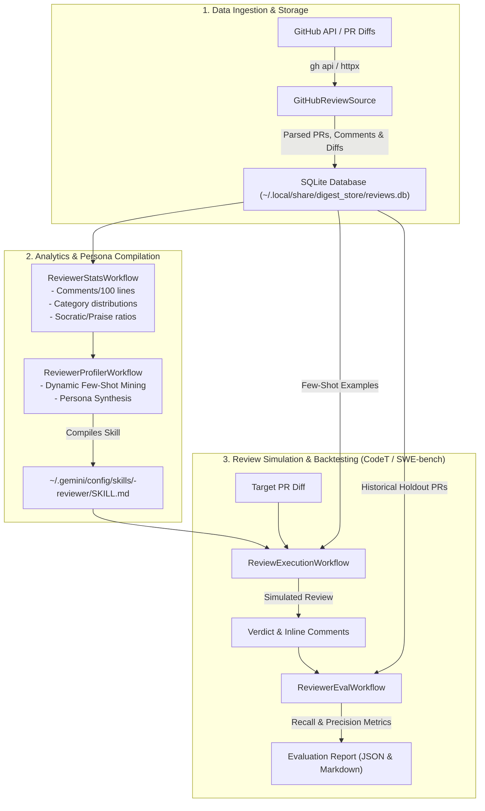

# Component Specification 04: AI Reviewer Persona Mimicry & Digestion Platform (`digest`)
**Component ID:** `reviewer-mimic-digest`  
**Target Package Path:** `~/EmptyOne/digest/`  
**Configuration File:** `~/EmptyOne/pyproject.toml`  
**Local SQLite Store:** `~/.local/share/digest_store/reviews.db`  
**Generated Skills Path:** `~/.gemini/config/skills/<reviewer>-reviewer/SKILL.md`  
**Dependencies:** Python 3.10+, `pydantic>=2.0`, `httpx>=0.27.0`, `rich>=13.0`, `pytest`  

---

## 1. System Topology & Architecture

The `digest` platform ingests historical code review histories from GitHub, analyzes reviewer tendencies and pet peeves, compiles autonomous persona skills into `~/.gemini/config/skills/`, and backtests review issue recall against unseen holdout pull requests.



---

## 2. Invariants & Mathematical Formulas

### 2.1 Comments Per 100 Lines Changed
Quantifies a reviewer's thoroughness / nitpickiness regardless of PR size:
$$\text{Comments per 100} = \frac{\text{Total Review Comments}}{\sum (\text{Additions} + \text{Deletions})} \times 100$$

### 2.2 Category Distribution Breakdown
Comments are categorized into 8 orthogonal buckets:
- `ARCHITECTURE`, `SECURITY`, `PERFORMANCE`, `TESTING`, `ERROR_HANDLING`, `STYLE_NITS`, `DOCUMENTATION`, `OTHER`.

### 2.3 Holdout Recall & Precision (CodeT Protocol)
To ensure the synthesized persona accurately mimics the reviewer without hallucinating irrelevant issues, the evaluation engine performs holdout cross-validation:
$$\text{Recall} = \frac{|\text{Simulated Issues} \cap \text{Actual Historical Issues}|}{|\text{Actual Historical Issues}|}$$
$$\text{Precision} = \frac{|\text{Simulated Issues} \cap \text{Actual Historical Issues}|}{|\text{Simulated Issues}|}$$
$$\text{F1-Score} = 2 \times \frac{\text{Precision} \times \text{Recall}}{\text{Precision} + \text{Recall}}$$

---

## 3. Package Configuration: `~/EmptyOne/pyproject.toml`

```toml
[build-system]
requires = ["setuptools>=61.0"]
build-backend = "setuptools.build_meta"

[project]
name = "digest"
version = "0.1.0"
description = "Unified Resource Digestion & AI Reviewer Persona Mimicry Platform"
readme = "PLAN_DIGESTION_AND_REVIEWER_MIMICRY.md"
requires-python = ">=3.10"
dependencies = [
    "pydantic>=2.0",
    "httpx>=0.27.0",
    "rich>=13.0"
]

[project.scripts]
digest = "digest.cli:main"

[tool.setuptools.packages.find]
where = ["."]
include = ["digest*"]
```

---

## 4. Core Package Implementations

### 4.1 Schema Models (`~/EmptyOne/digest/core/models.py`)

```python
from __future__ import annotations
from enum import Enum
from typing import Dict, List, Optional
from pydantic import BaseModel, Field


class ReviewVerdict(str, Enum):
    APPROVED = "APPROVED"
    CHANGES_REQUESTED = "CHANGES_REQUESTED"
    COMMENTED = "COMMENTED"
    DISMISSED = "DISMISSED"


class CommentCategory(str, Enum):
    ARCHITECTURE = "ARCHITECTURE"
    SECURITY = "SECURITY"
    PERFORMANCE = "PERFORMANCE"
    TESTING = "TESTING"
    ERROR_HANDLING = "ERROR_HANDLING"
    STYLE_NITS = "STYLE_NITS"
    DOCUMENTATION = "DOCUMENTATION"
    OTHER = "OTHER"


class ReviewComment(BaseModel):
    id: str
    pr_number: int
    repo: str
    author: str
    path: str
    line: Optional[int] = None
    diff_hunk: str = ""
    body: str
    created_at: str = ""
    category: CommentCategory = CommentCategory.OTHER
    is_socratic: bool = False
    is_praise: bool = False


class PullRequest(BaseModel):
    id: int
    number: int
    repo: str
    title: str
    body: Optional[str] = ""
    author: str
    state: str = "closed"
    diff: Optional[str] = ""
    changed_files: List[str] = Field(default_factory=list)
    additions: int = 0
    deletions: int = 0
    merged_at: Optional[str] = None


class Review(BaseModel):
    id: str
    pr_number: int
    repo: str
    author: str
    state: ReviewVerdict
    body: Optional[str] = ""
    submitted_at: str = ""
    comments: List[ReviewComment] = Field(default_factory=list)


class ReviewerStats(BaseModel):
    reviewer: str
    total_prs_reviewed: int
    total_comments: int
    avg_comments_per_pr: float
    comments_per_100_lines: float
    verdict_distribution: Dict[str, float]
    category_distribution: Dict[str, float]
    socratic_ratio: float
    praise_ratio: float
    top_reviewed_repos: List[str]


class EvalMetric(BaseModel):
    category: str
    expected_count: int
    predicted_count: int
    matched_count: int
    recall: float
    precision: float


class EvalSummary(BaseModel):
    reviewer: str
    total_holdout_prs: int
    overall_recall: float
    overall_precision: float
    f1_score: float
    metrics_by_category: List[EvalMetric]
    generated_at: str = ""
```

---

### 4.2 SQLite Storage Engine (`~/EmptyOne/digest/core/storage.py`)

```python
from __future__ import annotations
import json
import os
import sqlite3
from pathlib import Path
from typing import Dict, List, Optional, Tuple

from digest.core.models import (
    CommentCategory,
    PullRequest,
    Review,
    ReviewComment,
    ReviewerStats,
    ReviewVerdict,
)

DEFAULT_DB_PATH = os.path.expanduser("~/.local/share/digest_store/reviews.db")


class StorageEngine:
    def __init__(self, db_path: str = DEFAULT_DB_PATH):
        self.db_path = db_path
        if db_path != ":memory:":
            Path(db_path).parent.mkdir(parents=True, exist_ok=True)
        self.conn = sqlite3.connect(db_path)
        self.conn.row_factory = sqlite3.Row
        self._init_schema()

    def _init_schema(self) -> None:
        with self.conn:
            self.conn.execute("""
                CREATE TABLE IF NOT EXISTS pull_requests (
                    id INTEGER PRIMARY KEY,
                    number INTEGER,
                    repo TEXT,
                    title TEXT,
                    body TEXT,
                    author TEXT,
                    state TEXT,
                    diff TEXT,
                    changed_files TEXT,
                    additions INTEGER,
                    deletions INTEGER,
                    merged_at TEXT,
                    UNIQUE(repo, number)
                )
            """)
            self.conn.execute("""
                CREATE TABLE IF NOT EXISTS reviews (
                    id TEXT PRIMARY KEY,
                    pr_number INTEGER,
                    repo TEXT,
                    author TEXT,
                    state TEXT,
                    body TEXT,
                    submitted_at TEXT
                )
            """)
            self.conn.execute("""
                CREATE TABLE IF NOT EXISTS comments (
                    id TEXT PRIMARY KEY,
                    pr_number INTEGER,
                    repo TEXT,
                    author TEXT,
                    path TEXT,
                    line INTEGER,
                    diff_hunk TEXT,
                    body TEXT,
                    created_at TEXT,
                    category TEXT,
                    is_socratic BOOLEAN,
                    is_praise BOOLEAN
                )
            """)

    def save_pull_request(self, pr: PullRequest) -> None:
        with self.conn:
            self.conn.execute("""
                INSERT INTO pull_requests (
                    id, number, repo, title, body, author, state, diff,
                    changed_files, additions, deletions, merged_at
                ) VALUES (?, ?, ?, ?, ?, ?, ?, ?, ?, ?, ?, ?)
                ON CONFLICT(repo, number) DO UPDATE SET
                    title=excluded.title,
                    body=excluded.body,
                    diff=excluded.diff,
                    changed_files=excluded.changed_files,
                    additions=excluded.additions,
                    deletions=excluded.deletions
            """, (
                pr.id, pr.number, pr.repo, pr.title, pr.body, pr.author, pr.state,
                pr.diff, json.dumps(pr.changed_files), pr.additions, pr.deletions, pr.merged_at
            ))

    def save_review(self, review: Review) -> None:
        with self.conn:
            self.conn.execute("""
                INSERT OR REPLACE INTO reviews (
                    id, pr_number, repo, author, state, body, submitted_at
                ) VALUES (?, ?, ?, ?, ?, ?, ?)
            """, (
                review.id, review.pr_number, review.repo, review.author,
                review.state.value, review.body, review.submitted_at
            ))
            for c in review.comments:
                self.save_comment(c)

    def save_comment(self, comment: ReviewComment) -> None:
        with self.conn:
            self.conn.execute("""
                INSERT OR REPLACE INTO comments (
                    id, pr_number, repo, author, path, line, diff_hunk,
                    body, created_at, category, is_socratic, is_praise
                ) VALUES (?, ?, ?, ?, ?, ?, ?, ?, ?, ?, ?, ?)
            """, (
                comment.id, comment.pr_number, comment.repo, comment.author,
                comment.path, comment.line, comment.diff_hunk, comment.body,
                comment.created_at, comment.category.value,
                int(comment.is_socratic), int(comment.is_praise)
            ))

    def get_reviewer_prs(self, reviewer: str) -> List[PullRequest]:
        cursor = self.conn.execute("""
            SELECT DISTINCT pr.* FROM pull_requests pr
            JOIN reviews r ON pr.repo = r.repo AND pr.number = r.pr_number
            WHERE r.author = ? COLLATE NOCASE
        """, (reviewer,))
        rows = cursor.fetchall()
        prs = []
        for r in rows:
            prs.append(PullRequest(
                id=r["id"],
                number=r["number"],
                repo=r["repo"],
                title=r["title"] or "",
                body=r["body"] or "",
                author=r["author"] or "",
                state=r["state"] or "closed",
                diff=r["diff"] or "",
                changed_files=json.loads(r["changed_files"] or "[]"),
                additions=r["additions"] or 0,
                deletions=r["deletions"] or 0,
                merged_at=r["merged_at"]
            ))
        return prs

    def get_reviewer_comments(self, reviewer: str) -> List[ReviewComment]:
        cursor = self.conn.execute("""
            SELECT * FROM comments WHERE author = ? COLLATE NOCASE
        """, (reviewer,))
        rows = cursor.fetchall()
        comments = []
        for r in rows:
            cat_str = r["category"] or "OTHER"
            try:
                cat = CommentCategory(cat_str)
            except ValueError:
                cat = CommentCategory.OTHER
            comments.append(ReviewComment(
                id=r["id"],
                pr_number=r["pr_number"],
                repo=r["repo"],
                author=r["author"],
                path=r["path"] or "",
                line=r["line"],
                diff_hunk=r["diff_hunk"] or "",
                body=r["body"] or "",
                created_at=r["created_at"] or "",
                category=cat,
                is_socratic=bool(r["is_socratic"]),
                is_praise=bool(r["is_praise"])
            ))
        return comments

    def get_reviewer_verdict_for_pr(self, repo: str, pr_number: int, reviewer: str) -> str:
        cursor = self.conn.execute("""
            SELECT state FROM reviews
            WHERE repo = ? AND pr_number = ? AND author = ? COLLATE NOCASE
            ORDER BY submitted_at DESC LIMIT 1
        """, (repo, pr_number, reviewer))
        row = cursor.fetchone()
        return row["state"] if row else "COMMENTED"

    def close(self) -> None:
        self.conn.close()
```

---

## 5. Test Suite Implementation

### 5.1 Storage Tests (`~/EmptyOne/tests/test_storage.py`)
```python
import pytest
from digest.core.models import PullRequest, Review, ReviewComment, ReviewVerdict, CommentCategory
from digest.core.storage import StorageEngine

@pytest.fixture
def storage():
    engine = StorageEngine(":memory:")
    yield engine
    engine.close()

def test_save_and_retrieve_pull_request(storage):
    pr = PullRequest(
        id=101, number=42, repo="octocat/Hello-World", title="Add auth",
        body="JWT implementation", author="alice", additions=15, deletions=2
    )
    storage.save_pull_request(pr)
    
    rev = Review(
        id="rev_1", pr_number=42, repo="octocat/Hello-World", author="eval_user",
        state=ReviewVerdict.CHANGES_REQUESTED, submitted_at="2026-11-01T12:00:00Z"
    )
    storage.save_review(rev)
    
    prs = storage.get_reviewer_prs("eval_user")
    assert len(prs) == 1
    assert prs[0].number == 42
    assert prs[0].additions == 15
```

---

## 6. Setup & Verification Commands

```bash
cd ~/EmptyOne
source .venv/bin/activate
pip install -e ./digest
digest --help
pytest tests/ -v
```
