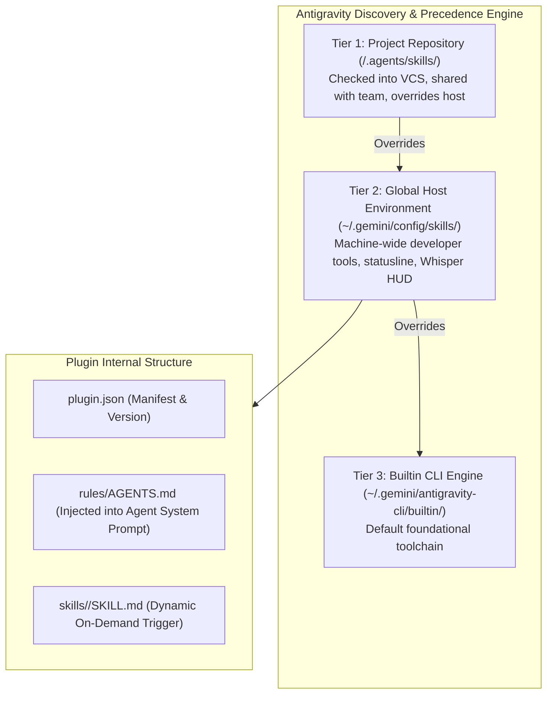

# Component Specification 05: Antigravity Customization Architecture, Plugins & Directives
**Component ID:** `antigravity-customizations`  
**Target Directories:**  
- Global Host Skills: `~/.gemini/config/skills/`  
- Autonomous Plugins: `~/.gemini/config/plugins/`  
- Active Workspace Rules: `~/.gemini/config/plugins/*/rules/AGENTS.md`  

---

## 1. Antigravity Customization Architecture & Discovery Priority

The Google Antigravity (AGY) agent runtime discovers and resolves skills, rules, and plugins through a strict 3-tier precedence hierarchy:



---

## 2. Invariants & Context Preservation Directives

1. **Context Window Token Preservation:** Skills are **not** dumped unconditionally into the LLM context window. Instead:
   - Behavioral directives in `rules/AGENTS.md` are active globally.
   - Heavy procedural instructions in `SKILL.md` are loaded **only when their trigger criteria are met** (e.g. non-coding tasks bypass `eval-coding-guidance` to save tokens).
2. **Standard YAML Frontmatter Contract:** Every skill directory must contain a valid `SKILL.md` with lowercase hyphenated frontmatter:
   ```yaml
   ---
   name: my-custom-skill
   description: Trigger-focused description with explicit keywords and scenarios.
   ---
   ```
3. **Idempotent Executable Scripts:** Scripts inside `scripts/` must enforce `set -euo pipefail`, handle Apple Silicon architectures, and maintain `chmod +x`.

---

## 3. Plugins Catalog (`~/.gemini/config/plugins/`)

| Plugin Directory | Description & Mission | Rule Path |
| :--- | :--- | :--- |
| `auto-skill-forge-plugin` | Autonomous skill generation and operational problem distillation whenever `/learn` is invoked or complex tasks are solved. | `rules/AGENTS.md` |
| `eval-coding-guidance-plugin` | SWE-bench, Reflexion, Agentless, Self-Debugging, CodeT guidelines. Enforces test-first reproduction and surgical minimality. | `rules/AGENTS.md` |
| `tooling-setup-recorder-plugin` | Automatically captures host developer tools, daemons, and CLI scripts into reusable recipes under `~/.gemini/config/skills/`. | `rules/AGENTS.md` |
| `modern-web-guidance-plugin` | Modern HTML/CSS/JS frontend standards, Container queries, View Transitions, `:has()`, Popover APIs. | `skills/modern-web-guidance/SKILL.md` |
| `prd-creation-plugin` | Deconstructs vague ideas into engineering-ready PRDs using a strict 4-Phase process. | `skills/prd-creation/SKILL.md` |
| `chrome-devtools-plugin` | Chrome DevTools MCP browser automation, a11y auditing, memory leak profiling. | `skills/chrome-devtools/SKILL.md` |

---

## 4. Skills Catalog (`~/.gemini/config/skills/`)

```
~/.gemini/config/skills/
├── setup-reconstitutor/      # Master autonomous setup rebuilder from blueprint specs
├── agy-statusline/           # Sub-15ms multi-line prompt statistics gauge and context gauge
├── macos-speech-dictation/   # Whisper Metal GPU push-to-talk dictation & 3-line pill HUD
├── meeting-recorder/         # 1-Click & ⌥ ⌥ meeting audio capture, ScreenCaptureKit, HTML notes
├── reviewer-mimic/           # PR review history ingestion & statistical persona profiling
├── eval_user-reviewer/       # Synthesized reviewer persona for @eval_user
├── willmcgugan-reviewer/     # Synthesized reviewer persona for @willmcgugan
├── noteworthy-notes/         # Executive meeting notes synthesizer with dynamic PV & tech sections
├── agi-remote/               # Sovereign remote messaging bridge & mobile WebSocket stream
├── plannotator/              # Interactive browser-based plan review gate & code review UI
└── github-cli/               # Automated gh CLI setup, credentials, and PR workflows
```

---

## 5. Verification & Acceptance Smoke Test

The reconstituting agent must verify that the catalog is populated and valid:

```bash
# 1. Verify Plugins exist
for p in auto-skill-forge-plugin eval-coding-guidance-plugin tooling-setup-recorder-plugin modern-web-guidance-plugin prd-creation-plugin chrome-devtools-plugin; do
    [ -d "$HOME/.gemini/config/plugins/$p" ] || { echo "Missing plugin: $p"; exit 1; }
done
echo "All 6 Plugins: VERIFIED ✅"

# 2. Verify Essential Skills have SKILL.md
for s in setup-reconstitutor agy-statusline macos-speech-dictation meeting-recorder reviewer-mimic; do
    [ -f "$HOME/.gemini/config/skills/$s/SKILL.md" ] || { echo "Missing SKILL.md in $s"; exit 1; }
done
echo "Essential Skills Frontmatter: VERIFIED ✅"
```
